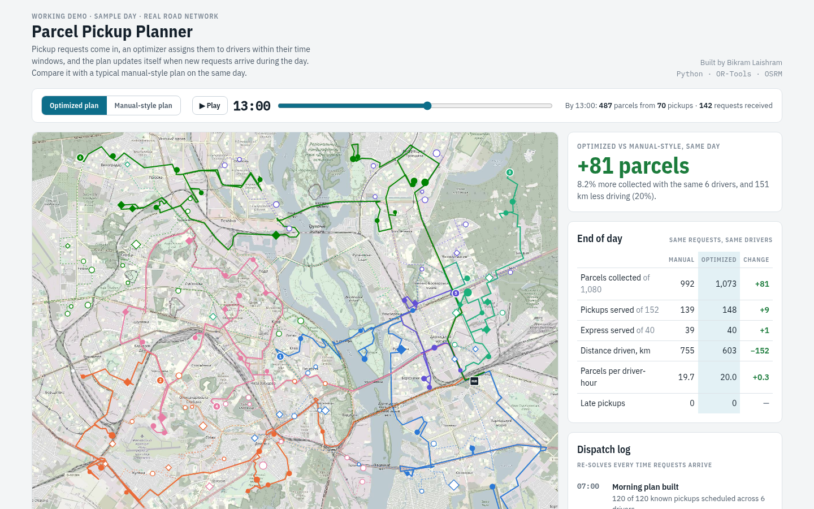

# Parcel Pickup Planner

**Plans parcel pickups for a team of drivers, keeps to customer time windows, and re-plans during the day as new requests come in.** Built with Google OR-Tools on real Kyiv road data, using sample requests.

**[▶ Live demo](https://bikramlaishram.github.io/parcel-pickup-optimizer/)**



## What it does

A dispatcher has 6 drivers, 152 pickup requests and a 9-hour shift. Most requests are known at 07:00, and more arrive during the day. The planner:

- assigns pickups to drivers within each customer's time window, van capacity and shift end
- puts express pickups first, then collects as many parcels as possible with as little driving as possible
- re-plans at 10:30, 12:30 and 14:00 from where each driver actually is, without pulling a driver off a stop they're already heading to
- runs the same day through a manual-style plan (fixed areas, nearest pickup next) so you can compare the two
- turns free-text customer messages into structured requests

The interactive page lets you replay the day, switch between the two plans, and read the dispatch log and driver notifications.

## Result on the sample day

From the committed `out/results.json`:

| | Manual-style | Optimized |
|---|---|---|
| Parcels collected (of 1,080) | 992 | 1,073 |
| Pickups served (of 152) | 139 | 148 |
| Express served (of 40) | 39 | 40 |
| Distance driven, km | 755 | 603 |
| Late pickups | 0 | 0 |

On five more generated days (`out/robustness.json`), the optimized plan collected 4.8% to 10.9% more parcels and drove 1.8% to 13.2% less.

## How it works

1. **Sample day** (`src/gen_data.py`): 6 drivers (08:00–17:00, 260-parcel vans). 120 requests are known at 07:00, and 32 more arrive in three waves. Each request has a parcel count, a time window and a priority. Points are random locations in Kyiv snapped to the road network with OSRM, and OSRM also provides the travel-time and distance matrix. The customers are placeholders, not real data.
2. **Planning** (`src/planner.py`):
   - *Manual-style:* each driver owns a fixed area around the hub and always drives to the pickup they can reach soonest.
   - *Optimized:* OR-Tools vehicle routing with time windows, capacity and priority-weighted drop penalties, using guided local search. The morning plan gets 20 seconds to solve and each re-plan gets 10. A re-plan starts from the drivers' current positions, locks stops already under way, starts from the previous plan, and adds a cost for moving a stop to another driver so routes stay stable.
3. **Intake** (`src/intake.py`): a deterministic parser for customer messages. A production version would use an LLM with a strict JSON schema and keep this parser as a check.
4. **Page** (`src/export.py`, `src/basemap.py`, `src/build_page.py`): builds a single self-contained HTML file with all data and an OpenStreetMap basemap inlined.
5. **Verification** (`src/verify.py`): re-checks the exported routes against the raw data without using any planner code.

**Assumptions:** drive times are OSRM free-flow times plus 35% for traffic. Each pickup takes 4 minutes plus 15 seconds per parcel.

## Tech stack

Python 3 · Google OR-Tools · OSRM (OpenStreetMap routing) · Pillow · a single static HTML/JS page, no framework or build step

## Run it locally

```bash
python3 -m venv .venv && source .venv/bin/activate
pip install ortools pillow

python3 src/run.py          # plan the sample day (about 1 minute)
python3 src/verify.py       # check the exported plan against the raw data
open index.html             # or just open the file in a browser
```

Rebuilding everything from scratch needs internet access, because it calls the public OSRM server and OpenStreetMap tile server:

```bash
python3 src/gen_data.py     # new sample day (SEED=7 by default)
python3 src/run.py
python3 src/export.py && python3 src/basemap.py && python3 src/build_page.py
python3 src/verify.py
python3 src/robustness.py   # five more seeds
```

## What was tested

- `src/verify.py` replays every exported route from `data/day.json` and checks time windows, recomputed arrival times, shift ends, van capacity, that no stop is served twice, that no driver heads to a request before it exists, and that parcel totals match the reported numbers. On the committed output it reports **0 problems** for both plans.
- `src/robustness.py` repeats the comparison on five independently generated days. The results are in `out/robustness.json`.

## Known limits

- **Sample data only.** Requests, customers and demand are synthetic. Only the road network is real.
- **Traffic is a flat +35%.** There are no time-of-day speeds or live traffic.
- **Results vary between runs.** The solver stops at a time limit, so re-running `src/run.py` can give slightly different numbers. A local run collected 1,079 parcels from 151 pickups, against 1,073 and 148 in the committed output.
- **Needs public services to rebuild.** Generating new data and basemaps calls the public OSRM demo server and OpenStreetMap tiles, which have usage limits.
- **Simple intake.** The message parser is rule-based and only handles the formats the generator produces.
- **No automated test suite or CI yet.** Verification is a script you run by hand.
- **Fixed scenario:** one hub, identical vans, and everything happens on one day.

## Credits

Map tiles and road data © OpenStreetMap contributors (ODbL). Routing by OSRM.

No license file has been added yet, so all rights are reserved by default.

Author: [Bikram Laishram](https://github.com/bikramlaishram) · [AcuityGen](https://github.com/acuitygen)
